<div align="center">

# ⚡ Addy Clips

### Your local-first AI gaming video clipping studio.

**Turn long gameplay recordings into vertical/landscape highlight clips.** Upload a local file or Twitch VOD, and Addy Clips uses Gemini Flash for frame analysis to find the best moments. All data stays on your machine via Docker Compose.

[](https://www.python.org/)
[](https://fastapi.tiangolo.com/)
[](https://nextjs.org/)
[](https://ffmpeg.org/)
[](https://www.docker.com/)
[](LICENSE)

### ⭐ [Star the repo](https://github.com/your-username/addy-clips) to support local-first clipping

</div>

---

## 🎬 Real Output

Upload a 2-hour gameplay recording, get ready-to-post shorts out:

```bash
# Just upload via the dashboard at http://localhost:3000
# Or use the API directly
curl -X POST http://localhost:8000/api/source/local-upload \
  -F "file=@gameplay.mp4"
```

<table>
<tr>
<td align="center" width="50%">
<br>
<sub>🎮 Dark production workspace — Processing tab shows live worker stages</sub>
</td>
<td align="center" width="50%">
<br>
<sub>📱 Searchable gallery with vertical/landscape preview and one-click download</sub>
</td>
</tr>
</table>

---

## 🎯 Why Addy Clips?

When you have hours of gameplay footage, finding the highlights is tedious.

- 🎮 **Local-first & private** — Your videos never leave your machine. No cloud uploads, no accounts.
- 🤖 **AI-powered analysis** — Gemini Flash analyzes sampled frames to detect hype moments, not just audio spikes.
- ⚡ **Dual export** — Every clip rendered in both 9:16 (Shorts/TikTok/Reels) and 16:9 (YouTube/archives).
- 🔧 **Zero-config Docker** — `docker compose up` and you're running. No external Redis, no database server.
- 🎬 **Complete pipeline** — Upload → Analyze → Render → Gallery → Download, all in one dashboard.

---

## ✨ Features

| | Feature | What it does |
|---|---|---|
| 📁 | **Manual VOD Upload** | Drag-and-drop MP4, MOV, MKV, WebM, AVI — FFprobe validates instantly |
| 🤖 | **Gemini Flash Analysis** | Samples up to 24 frames, detects moments by visual + audio cues |
| ✂️ | **Smart Moment Detection** | Scores moments by category (Action, Funny, Reactions, Story, etc.) with deduplication |
| 📱 | **Dual Format Export** | Center-crop 1080×1920 (vertical) + 1920×1080 (landscape), H.264 CRF 22, audio preserved |
| 🎤 | **Optional AI Titles** | Gemini generates engaging titles, descriptions, hashtags per clip |
| 💬 | **Optional Captions** | Local faster-whisper transcription burned into exports (CPU, no cloud) |
| 🔍 | **Searchable Gallery** | Filter by category, search titles, paginated clip library |
| ▶️ | **Range-Request Streaming** | Preview clips in browser without full download |
| 🐳 | **Docker Compose** | Single command, CPU-only, SQLite WAL mode, no external services |
| ⚙️ | **Worker Concurrency** | 1–4 parallel jobs, tunable for your hardware |

---

## 🧠 How It Works

```mermaid
flowchart LR
    A[Local File / Twitch VOD] --> B[Frontend Dashboard]
    B --> C[FastAPI: Queue Job]
    C --> D[SQLite Job Queue]
    D --> E[Python Worker]
    E --> F[FFprobe: Validate Source]
    F --> G[FFmpeg: Sample Frames]
    G --> H[Gemini Flash: Analyze Frames]
    H --> I[Normalize & Rank Moments]
    I --> J[FFmpeg: Render Clips]
    J --> K[Vertical 9:16 + Landscape 16:9]
    K --> L[Clip Gallery + Metadata]
```



**Worker Pipeline Stages:**
1. **Preparing source** (8%) — FFprobe validation
2. **Sampling gameplay frames** (20%) — Extract up to 24 frames (640px wide)
3. **Analyzing gameplay** (36%) — POST frames to internal API with Gemini key
4. **Generating clips** (48–95%) — FFmpeg render: dual format, H.264 veryfast CRF 22
5. **Complete** (100%) — Persist clip metadata to SQLite

---

## 🚀 Quick Start

### Prerequisites
- **Docker Engine** or **Docker Desktop** with Compose V2
- Optional: **Gemini API key** from [Google AI Studio](https://aistudio.google.com/apikey) for AI titles
- Recommended: 4+ CPU cores, 8 GB RAM, disk space ≥ source size + exports

### Install

```bash
git clone https://github.com/your-username/addy-clips.git
cd addy-clips
cp .env.example .env
# Edit .env to add your GEMINI_API_KEY (optional but recommended)
docker compose up -d --build
```

Open **http://localhost:3000** — the dashboard loads instantly.

---

## 🎮 Usage

### 1. Upload a Local Recording (Primary Workflow)

1. Open the dashboard at `http://localhost:3000`
2. Click **"Upload Local Video"** — drag & drop your MP4/MOV/MKV/WebM/AVI
3. Configure analysis:
   - **Clip count:** 1–10 clips
   - **Clip length:** 15–60 seconds each
   - **Sensitivity:** Relaxed / Balanced / Aggressive
   - **Categories:** Action, Funny, Reactions, Story, Exploration, Chat hype
   - **Optional:** Enable AI titles & captions
4. Click **Start Analysis** — watch live progress in the Processing tab
5. When complete, browse **My Clips** — preview, edit metadata, download MP4s

### 2. Twitch VOD (Supported)

Paste a Twitch VOD URL (`twitch.tv/videos/123456789`) — Addy Clips downloads via Streamlink and processes like a local file.

### 3. YouTube Live / VOD (🧪 Beta / Coming Soon)

> **Status:** YouTube URL processing is experimental. The YouTube Data API provides metadata only — video byte access requires creator-authorized OAuth. Local uploads work reliably today; YouTube link support is being improved.

---

## 🖼️ Layouts & Output

| Format | Resolution | Codec | Use Case |
|---|---|---|---|
| **Vertical** | 1080×1920 (9:16) | H.264 CRF 22 | TikTok, Reels, Shorts |
| **Landscape** | 1920×1080 (16:9) | H.264 CRF 22 | YouTube, archives, Discord |

> **Note:** Current implementation uses center-crop fallback. Smart subject tracking is not yet implemented.

---

## ⚙️ Configuration

All settings via `.env` (copy from `.env.example`):

| Variable | Default | Description |
|---|---|---|
| `FRONTEND_PORT` | `3000` | Dashboard port |
| `BACKEND_PORT` | `8000` | API port |
| `DATA_DIR` | `./data` | Persistent data directory |
| `WORKER_CONCURRENCY` | `1` | Parallel jobs (1–4) |
| `GEMINI_API_KEY` | *(empty)* | Optional: enables AI titles |
| `YOUTUBE_API_KEY` | *(empty)* | Optional: YouTube metadata lookup |
| `NEXT_PUBLIC_API_URL` | `http://localhost:8000` | Backend URL for browser |
| `PUID` / `PGID` | `1000` / `1000` | Linux data dir ownership |

---

## 🐳 Docker Operations

```bash
# Start all services
docker compose up -d --build

# View logs
docker compose logs -f          # all
docker compose logs -f api      # API only
docker compose logs -f worker   # Worker only
docker compose logs -f frontend # Frontend only

# Stop
docker compose down

# Rebuild after changes
docker compose up -d --build
```

---

## 📁 Data Layout (Persisted in `./data/`)

```
data/
├── clips/{project_id}/{clip_id}/
│   ├── vertical_9_16.mp4
│   ├── landscape_16_9.mp4
│   ├── thumbnail.jpg
│   └── metadata.json
├── projects/{project_id}/
│   └── source.{mp4|mov|...}
├── temp/{job_id}/              # Frame samples (cleaned after job)
├── database/addy-clips.sqlite3
└── logs/
```

**Backup:** Stop stack (`docker compose down`), copy entire `data/` directory.

---

## 🔒 Security & Privacy

- **No authentication** — Dashboard binds to loopback (127.0.0.1) by design
- **No external network calls** except:
  - Gemini API (only when you enable AI titles)
  - YouTube Data API (metadata only, optional)
  - Streamlink for Twitch (when you provide a Twitch URL)
- **Gemini keys** — Stored in browser localStorage → sent to API → held in memory → never in SQLite → never sent to worker
- **Do not expose directly to internet** — Use reverse proxy + HTTPS + access control for remote access

---

## 🩺 Troubleshooting

| Problem | Fix |
|---|---|
| API unavailable | `docker compose logs -f api`; verify `BACKEND_PORT` and `NEXT_PUBLIC_API_URL` |
| Unsupported/corrupt file | Confirm FFmpeg reads it; check `.env` size/duration limits |
| Gemini rejected key | Valid key? Gemini API enabled in Google Cloud project? |
| No clips found | Try higher sensitivity or shorter source; inspect job error |
| Exports slow | CPU encoding; increase `WORKER_CONCURRENCY` if resources allow |
| YouTube metadata only | Expected — upload local file for processing |

---

## 🛠️ Development

### Backend (FastAPI)
```bash
cd backend
pip install -r requirements.txt
uvicorn app.main:app --host 0.0.0.0 --port 8000 --reload
python -m app.worker  # run worker separately
python -m pytest      # tests
```

### Frontend (Next.js 16)
```bash
cd frontend
npm install
npm run dev           # http://localhost:3000
npm run build         # production build
```

### Key Files
- `backend/app/main.py` — FastAPI app, all endpoints, job key management
- `backend/app/worker.py` — Worker loop, pipeline, FFmpeg rendering
- `backend/app/services/ai.py` — Gemini Flash frame analysis
- `backend/app/services/detection.py` — Moment normalization, scoring, deduplication
- `frontend/app/page.tsx` — Single-page dashboard (Dashboard, Processing, My Clips, History, Settings)

---

## 🗺️ Roadmap

- [ ] Smart subject tracking for vertical crops (face/object detection)
- [ ] YouTube OAuth integration for creator-authorized VOD access
- [ ] Twitch live clipping with rolling replay buffer
- [ ] Custom category training / few-shot prompting
- [ ] Batch project processing
- [ ] Export presets (TikTok, Reels, Shorts optimized)
- [ ] Clip collections / playlists
- [ ] Webhook notifications (Discord, Slack)

---

## 🧱 Built With

[FFmpeg](https://ffmpeg.org) · [FastAPI](https://fastapi.tiangolo.com) · [Next.js](https://nextjs.org) · [React 19](https://react.dev) · [Tailwind CSS 4](https://tailwindcss.com) · [SQLite](https://sqlite.org) · [Gemini Flash](https://ai.google.dev) · [faster-whisper](https://github.com/SYSTRAN/faster-whisper) · [Streamlink](https://streamlink.github.io) · [yt-dlp](https://github.com/yt-dlp/yt-dlp)

---

## ⚖️ Responsible Clipping

- Respect streamers, creators, and platform terms of service
- Get permission or join official clip campaigns before reposting/monetizing
- Addy Clips does not bypass DRM, paywalls, or authentication
- Credit the original creator when you post

You are responsible for what you publish.

---

## 🤝 Contributing

Bug reports, ideas, and PRs welcome. See [CONTRIBUTING.md](CONTRIBUTING.md).

```bash
cd backend && python -m pytest -q   # fast tests, no ffmpeg or network needed
```

---

## 📄 License

[MIT](LICENSE) © 2026

---

<div align="center">

Made with ❤️ for the gaming creator community

If this saved you time, ⭐ the repo and share it with fellow clippers.

</div>